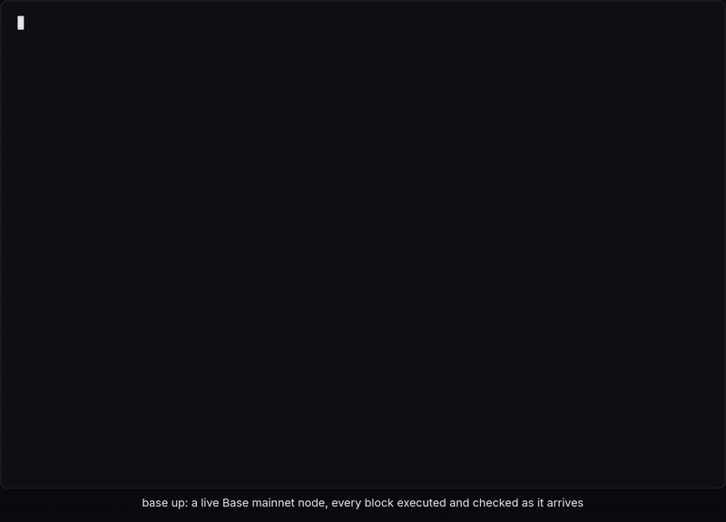

# needlefish

[](#installation)
[](#installation)
[](#design)
[](#status)
[](LICENSE)

**[Base](https://base.org), the Ethereum L2, rewritten from scratch in Zig.**

needlefish is a complete Base node stack: execution client, rollup consensus node, block
builder, batcher, and fault-proof tooling, built on the Zig standard library and nothing
else. It is a ground-up port of [base/base](https://github.com/base/base) and keeps its
layout, so every crate there has an obvious home here. L2 blocks are full blocks at Base's
native 200 ms cadence.

<p align="center">
  
</p>

## Highlights

- **Syncs Base mainnet.** A needlefish node has executed more than 2 million consecutive
  mainnet blocks from a verified snapshot, with every block's state root, receipts root, gas,
  bloom, and hash matching the canonical chain. Its safe and finalized heads match
  mainnet.base.org's.
- **Zero dependencies.** Keccak, secp256k1, BN254, BLS12-381, KZG, brotli, the EVM, the trie,
  the storage engine, devp2p, HTTP, and JSON-RPC are all implemented here.
- **Tested like a database.** Deterministic simulation of the whole cluster with fault
  injection, coverage-guided fuzzing of every decoder, and differential tests against public
  Ethereum vectors.
- **Fast.** Executes Base mainnet blocks 1.3x faster than base/base's node (revm), and
  standard EVM benchmarks 1.8-1.9x faster than revm. See the [benchmarks](#benchmarks).

## Status

needlefish runs on Base mainnet as a verifying node. The first one started from Base's public
reth snapshot at block 54528124 and accepted it only after recomputing the state root from
every account and storage slot. By November 13, 2026, it had executed 2.3 million
consecutive blocks. At the tip it executes the sequencer-signed block from Base's consensus
gossip network as soon as it arrives, checks it like any other block, and falls back to
execution-layer peers when gossip is late. Over its latest 44,000 blocks, 99% came from
gossip and the median lag was 22 ms (p90 59 ms, p99 284 ms). In the recording above,
`base up` shows 299 consecutive blocks in 60 s, every check passing, at 33 ms of lag on
average (median 23 ms, at most 273 ms). About 1 block in 500 still takes over a second, when
the disk it shares with other workloads is busy. Every 5 minutes, a sampler compares
balances, nonces, code, storage, and proofs at the head with the public chain; it has found
0 mismatches in 7,266 calls.

## Installation

```sh
git clone https://github.com/refcell/needlefish && cd needlefish
just release
```

`just release` needs [just](https://github.com/casey/just) and `curl`. It uses Zig 0.17.1 from
your `PATH`, or downloads it, and writes optimized binaries to `zig-out/bin`. There are no
other build dependencies and no tagged releases yet; build from `main`.

## Usage

Everything ships in one binary, `base`, with a subcommand for each of base/base's entry
points: `node`, `consensus`, `batcher`, `proposer`, `challenger`, `replay`, operator tools,
and more. Run `base` with no arguments to list them.

### Run a Base mainnet node

```sh
base up
```

`base up` takes a machine from nothing to a node at the tip of Base mainnet:

1. It checks the setup first: disk space, ports, and the L1 endpoints.
2. It downloads Base's latest public snapshot and imports it. The import recomputes the state
   root from every account and storage slot and requires it to match the snapshot block's
   header.
3. It runs the execution node, which executes and checks every block it gets from peers.
4. It runs the consensus node, which derives the safe and finalized heads from Ethereum L1.

Run it again to resume after an interruption; it never re-imports over a verified database.
On a datadir where a node is already running, it shows that node's live view instead. The
[mainnet guide](docs/MAINNET.md) covers the hardware it needs (about 3.5 TB of NVMe), each
step in detail, and the node's current limits.

### History and transactions

The execution node keeps a bounded window of history, not all of it. Started with
`--archive <file>`, it stores every block it executes on disk: the block, its transactions
and receipts, and the value each account, storage slot, and trie node had before the block
changed it. State queries (`eth_getBalance`, `eth_getCode`, `eth_getStorageAt`,
`eth_getTransactionCount`, `eth_call`, `eth_getProof`) then answer at any block in the
window, by number or by hash. Blocks, transactions, and receipts are served from the window
once they leave the 16,384-block in-memory ring.

The file has a fixed size, `--archive.size-gb` (default 512). On mainnet a block takes
about 343 KiB, or 141 GiB a day, so the default holds about 1.5 million blocks, or 3.6
days. When the file is full, the oldest blocks go. A block outside the window is refused
with an error that names the window. A full archive is out of reach for this design: at
today's density, mainnet's 56 million blocks would need about 20 TB, ten times the node's
whole database. A node that starts from a snapshot has also never executed the older
blocks. Use an archive endpoint for those.

`eth_sendRawTransaction` checks the transaction and adds it to the node's pool
(`txpool_status`, the `pending` nonce). With `--rollup.sequencer-http
https://mainnet-sequencer.base.org`, it also forwards the transaction to the Base sequencer
and returns the sequencer's answer, as base/base and op-geth do.

On a mainnet node that archived 23,754 blocks, 1,734 state answers at past blocks (balances,
nonces, code, storage, and `eth_call`, by number and by hash) and blocks, transactions, and
receipts from the archive all matched mainnet.base.org. Twenty `eth_getProof` answers
matched base.drpc.org exactly; mainnet.base.org does not serve proofs that old.

### Replay mainnet blocks

```sh
just replay        # fetch the latest 10 Base mainnet blocks and replay them offline
just replay 100    # the same for the latest 100
```

Replay fetches recent blocks and the state they touch from public RPC, re-executes them
offline, and checks every header field against the chain. It needs no snapshot and no disk
beyond a small cache. [Learn how replay works](docs/REPLAY.md).

### Differential fuzzing adapter

```sh
zig build -Doptimize=ReleaseSafe
zig-out/bin/base diff-adapter < requests.jsonl
```

`base diff-adapter` runs one block per JSON line on needlefish's block execution path, with
pre-state from a stateless witness, and answers with every header field, receipt, and state
change it computes. A differential fuzz harness compares those answers with base/base and
other clients. The protocol and its code live in `src/infra/diff_adapter`.

Its `trie` mode (base/base's `TRIE_PROTOCOL.md`) applies blocks of state writes given in
hashed key space to needlefish's own on-disk database in the request's `trie.dir`: disk mode,
committed as the node commits a block (`StateDb.commit_hashed`, `Database.commit_applied`),
with native unwinds and eth_getProof's proofs. Its `variants` are other root paths: `sparse`
(the stateless `SparseState`), `state-trie` (the in-memory `StateTrie`), `hash-builder` (the
whole state from scratch), `disk-small` (the primary's path over a database at the smallest
sizes the node allows, so it flushes and checkpoints every block and compacts every few),
`disk-small-reopen` (the same, restarted after every block, cleanly or as a crash), `disk-deep`
(blocks split into blocks of 8 + 8 writes over even smaller entries, so its trees reach level
2), and, when the request carries preimages, `node-address` (the durable node's address-keyed
path). Its coverage is `nf:edge:<index>` of the trie, state database and storage engine
functions only.

For coverage-guided fuzzing, build with `-Ddiff-coverage` and set `BASE_DIFF_COVERAGE=1`:

```sh
zig build -Doptimize=ReleaseSafe -Ddiff-coverage -p zig-out-coverage
BASE_DIFF_COVERAGE=1 zig-out-coverage/bin/base diff-adapter < requests.jsonl
```

Each response then carries `"coverage": {"nf:<feature>": <count>, ...}`, which the harness
does not compare:

- `nf:op:<opcode>:<fork>:d<depth>`: instructions by EVM fork and call depth bucket.
- `nf:exit:<opcode>:<outcome>`: the instruction that ended a frame's run, and how.
- `nf:pre:<address>:l<k>[w]:<result>`: precompile calls by input length (`2^(k-1)` up to
  `2^k` bytes, `w` for whole words) and result.
- `nf:native:<contract>:<selector>:<result>[:<revert selector>]`: native precompile calls;
  B-20 tokens appear by variant.
- `nf:tx:<type>:<outcome>`: transactions by type: `ok`, `failed`, or the rejection.
- `nf:edge:<index>`: compiler edge counters (`-ffuzz`, 8-bit, so counts wrap at 256) inside
  EVM and crypto functions, reset per request. Indices are stable for one binary only.

The flag needs an optimized build (the LLVM backend emits the counters), and it does not
change results. It instruments the whole `base` module, so the binary runs about 1.7x slower
with coverage off and 1.9x with it on (ReleaseSafe, synthetic fuzz requests). A request that
first fills a cache (code analysis, the warm-address set) can show a few more edges than the
same request later. Without the flag the hooks compile away; the variable then makes the adapter
exit with an error rather than report nothing.

The same `-Ddiff-coverage` build adds a `fuzz_coverage` JSON-RPC method to `base node`, on the
normal HTTP port, for a coverage-guided JSON-RPC fuzzer:

```sh
zig build -Doptimize=ReleaseSafe -Ddiff-coverage -p zig-out-coverage
zig-out-coverage/bin/base node --chain genesis.json --http.port 8545
curl -s localhost:8545 -H 'content-type: application/json' \
  -d '{"jsonrpc":"2.0","id":1,"method":"fuzz_coverage","params":[]}'
```

It answers `{"counters": <kept counters>, "hits": [[index, count], ...]}`: every kept edge
counter hit since the previous call (or process start), by index, with its 8-bit count, and
then zeroes all counters. An index is the counter's position among the kept ones, stable for
one binary. Kept counters lie in functions named with one of the comma-separated prefixes in
`BASE_RPC_COVERAGE_PREFIXES`, by default the JSON-RPC serving code (HTTP, JSON-RPC, JSON, the
RPC handlers and tracers, block-store lookups, RLP and consensus types, the EVM, and crypto):
`utilities.http.,utilities.rpc.,utilities.json.,execution.rpc.,execution.node.block_store.,`
`common.rlp.,common.consensus.,execution.evm.,common.crypto.`. Counters are process-wide and
not atomic, so send requests one at a time. Block import and timers also run some kept code
(the EVM, RLP, the HTTP server), so discard the reading after the chain advances. Without the
flag the method does not exist (-32601).

### Local devnet

The devnet runs natively, with no Docker and no external L1: needlefish brings its own L1 dev
chain.

```sh
just devnet up       # generate configs and start every component
just devnet status   # processes and chain heads
just devnet smoke    # end to end: an L2 transaction is sequenced, batched, and derived
just devnet logs     # follow every log
just devnet down     # stop everything
just devnet reset    # wipe the devnet and start fresh
```

| Process | Command | Ports |
| --- | --- | --- |
| L1 dev chain | `base node --dev-l1` | http 8545, beacon 5052 |
| L2 sequencer EL | `base node` | http 9545, engine 9551 |
| L2 sequencer CL | `base consensus --sequencer` | rpc 7545 |
| Batcher | `base batcher` | metrics 7300 |
| L2 verifier EL | `base node` | http 10545, engine 10551 |
| L2 verifier CL | `base consensus` | rpc 8547 |

L1 is chain 900 with 2 s blocks; L2 is chain 901 with 200 ms blocks and every hardfork active
at genesis. Prefunded accounts come from the public dev mnemonic
`test test test test test test test test test test test junk`. Everything the devnet writes,
including its generated JWT secret, stays in a git-ignored `.devnet` directory. The
[devnet guide](docs/DEVNET.md) documents every process, flag, and the smoke test.

## Design

- **Zero dependencies.** Only the Zig standard library: no C libraries and no vendored code.
- **TigerStyle.** Assertions on every precondition, postcondition, and invariant; static
  allocation at startup; every loop and queue bounded; no recursion; short functions. Read
  the [style guide](docs/TIGER_STYLE.md).
- **Deterministic simulation testing.** All network, disk, time, and randomness go through an
  injected IO layer. The simulator runs the real components on simulated infrastructure with
  fault injection, and any run replays exactly from its seed.
- **Fuzzed.** Every decoder, parser, and state machine has a coverage-guided fuzz target and a
  seeded fuzz run that executes with the normal test suite.
- **io_uring.** Completion-based IO on Linux, kqueue on macOS, and the same API in simulation.

The [architecture overview](docs/ARCHITECTURE.md) shows how the pieces fit together.

## Benchmarks

Measured on one core of an AMD Ryzen AI MAX+ 395 (Zen 5), mainnet blocks on November 18, 2026 (idle
machine) and EVM fixtures on November 13, with needlefish built `ReleaseSafe` (the shipped build) and
`ReleaseFast`, and the Rust side built for the same CPU. Each comparison names what it runs
on the other side:

| Workload | Compared with | needlefish | Other side | needlefish speedup (95% CI) |
| --- | --- | ---: | ---: | ---: |
| 100 Base mainnet blocks (53775088+), EVM execution per window | base/base node (`base-reth-node`'s block execution path, revm) | 104.3 ms | 135.8 ms | **1.30x** (1.27–1.32; `ReleaseFast` 1.36x) |
| Same blocks, execution + receipts root + state commit | base/base node (same path, with `merge_transitions`) | 108.6 ms | 141.8 ms | **1.31x** (1.27–1.32) |
| 31 standard EVM fixtures (evm2's suite), geometric mean | revm 43 | | | **1.94x** (`ReleaseFast` 2.11x) |
| 31 standard EVM fixtures (evm2's suite), geometric mean | evm2 (reth's new EVM, stable build) | | | **1.76x** |
| Synthetic devnet chain, `engine_newPayload` median (earlier run, 4-vCPU VM) | `base-reth-node` | 4.00 ms | 8.03 ms | **2.0x** |

- **Mainnet blocks.** Both sides execute the same blocks from the same pre-state, held in
  memory, single-threaded, with senders recovered beforehand. Every block must reproduce its
  canonical gas used and receipts root, or the run fails. The base/base side is the code
  `base-reth-node` runs on a new payload: its `BaseEvmConfig`, reth's `executor_for_block`,
  every transaction, the post-block changes and `merge_transitions`, built with the node's
  `asm-keccak` and `keccak-cache-global` features. Its database is replaced by an in-memory
  `CacheDB`, which favours it (a node reads accounts and slots from MDBX), and its precompile
  result cache is not installed. Times are medians of one pass over the window, over 10 fresh
  processes per side, on an idle machine. An earlier 1.39x, measured while other work kept
  the machine busy, overstated the lead and is replaced. State roots are not in this comparison: reth computes them against its
  database, and an offline harness for that does not exist yet.
- **EVM fixtures.** One transaction per case, repeated on a reused EVM after an untimed state
  reset, every engine reporting the same gas used. revm and evm2 run through evm2's own CLI at
  the pinned commit. The cases range from 21k-gas transfers (needlefish about 2x revm) to
  contract-heavy ones such as Uniswap, Curve, and Seaport (1.7–2.3x). A November 16 rerun
  of the current build under the same machine load measured 1.78x revm and 1.86x evm2; the
  older build measured lower against revm in that run too.
- **Not compared here.** Earlier versions of this table compared against base/base's fault
  proof executor (`base-proof-executor`), which re-hashes its whole trie on every block; that
  is not how a Base node runs. Those numbers stay in the
  [full report](docs/BENCHMARKS.md#proof-executor-comparison), labelled as such.

The [full benchmark report](docs/BENCHMARKS.md) has every case, the method, and scripts to
reproduce each number. Micro benchmarks run with `just bench` and are tracked in the
[performance notes](docs/PERF.md).

## Documentation

- [Mainnet guide](docs/MAINNET.md): run a node that syncs Base mainnet.
- [Replay](docs/REPLAY.md): re-execute mainnet blocks offline.
- [Devnet](docs/DEVNET.md): the local all-Zig devnet.
- [Architecture](docs/ARCHITECTURE.md): how the components fit together.
- [Benchmarks](docs/BENCHMARKS.md): methodology and full results.
- [Sync plan](docs/SYNC_PLAN.md): the road to a fully verified mainnet node.
- [Style guide](docs/TIGER_STYLE.md): the TigerStyle rules this codebase follows.

## Contributing

Run `just` to list every development recipe: tests, fuzzing, deterministic simulation, and
benchmarks. Read the [contributor guide](AGENTS.md) before opening a change; it covers the
rules every commit follows.

## License

needlefish is released under the [MIT License](LICENSE).
