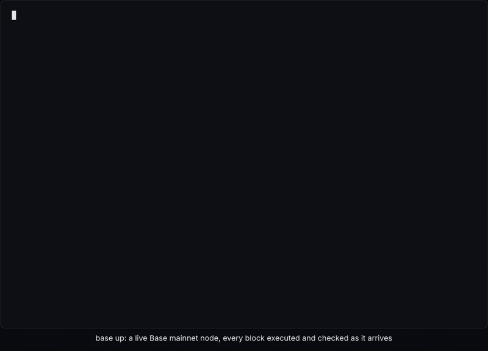

# needlefish

[](#installation)
[](#installation)
[](#design)
[](#status)
[](LICENSE)

**[Base](https://base.org), the Ethereum L2, rewritten from scratch in Zig.**

needlefish is a complete Base node stack: execution client, rollup consensus node, block
builder, batcher, and fault-proof tooling, built on the Zig standard library and nothing
else. It is a ground-up port of [base/base](https://github.com/base/base) and keeps its
layout, so every crate there has an obvious home here. L2 blocks are full blocks at Base's
native 200 ms cadence.

<p align="center">
  
</p>

## Highlights

- **Syncs Base mainnet.** A needlefish node has executed more than 2 million consecutive
  mainnet blocks from a verified snapshot, with every block's state root, receipts root, gas,
  bloom, and hash matching the canonical chain. Its safe and finalized heads match
  mainnet.base.org's.
- **Zero dependencies.** Keccak, secp256k1, BN254, BLS12-381, KZG, brotli, the EVM, the trie,
  the storage engine, devp2p, HTTP, and JSON-RPC are all implemented here.
- **Tested like a database.** Deterministic simulation of the whole cluster with fault
  injection, coverage-guided fuzzing of every decoder, and differential tests against public
  Ethereum vectors.
- **Fast.** Up to 24x faster than base/base's executor on mainnet blocks once state roots
  are included. See the [benchmarks](#benchmarks).

## Status

needlefish runs on Base mainnet as a verifying node. The first one started from Base's public
reth snapshot at block 54528124 and accepted it only after recomputing the state root from
every account and storage slot. By November 13, 2026, it had executed 2.3 million
consecutive blocks. At the tip it executes the sequencer-signed block from Base's consensus
gossip network as soon as it arrives, checks it like any other block, and falls back to
execution-layer peers when gossip is late. Over its latest 44,000 blocks, 99% came from
gossip and the median lag was 22 ms (p90 59 ms, p99 284 ms). In the recording above,
`base up` shows 299 consecutive blocks in 60 s, every check passing, at 33 ms of lag on
average (median 23 ms, at most 273 ms). About 1 block in 500 still takes over a second, when
the disk it shares with other workloads is busy. Every 5 minutes, a sampler compares
balances, nonces, code, storage, and proofs at the head with the public chain; it has found
0 mismatches in 7,266 calls.

## Installation

```sh
git clone https://github.com/refcell/needlefish && cd needlefish
just release
```

`just release` needs [just](https://github.com/casey/just) and `curl`. It uses Zig 0.17.1 from
your `PATH`, or downloads it, and writes optimized binaries to `zig-out/bin`. There are no
other build dependencies and no tagged releases yet; build from `main`.

## Usage

Everything ships in one binary, `base`, with a subcommand for each of base/base's entry
points: `node`, `consensus`, `batcher`, `proposer`, `challenger`, `replay`, operator tools,
and more. Run `base` with no arguments to list them.

### Run a Base mainnet node

```sh
base up
```

`base up` takes a machine from nothing to a node at the tip of Base mainnet:

1. It checks the setup first: disk space, ports, and the L1 endpoints.
2. It downloads Base's latest public snapshot and imports it. The import recomputes the state
   root from every account and storage slot and requires it to match the snapshot block's
   header.
3. It runs the execution node, which executes and checks every block it gets from peers.
4. It runs the consensus node, which derives the safe and finalized heads from Ethereum L1.

Run it again to resume after an interruption; it never re-imports over a verified database.
On a datadir where a node is already running, it shows that node's live view instead. The
[mainnet guide](docs/MAINNET.md) covers the hardware it needs (about 3.5 TB of NVMe), each
step in detail, and the node's current limits.

### History and transactions

The execution node keeps a bounded window of history, not all of it. Started with
`--archive <file>`, it stores every block it executes on disk: the block, its transactions
and receipts, and the value each account, storage slot, and trie node had before the block
changed it. State queries (`eth_getBalance`, `eth_getCode`, `eth_getStorageAt`,
`eth_getTransactionCount`, `eth_call`, `eth_getProof`) then answer at any block in the
window, by number or by hash. Blocks, transactions, and receipts are served from the window
once they leave the 16,384-block in-memory ring.

The file has a fixed size, `--archive.size-gb` (default 512). On mainnet a block takes
about 343 KiB, or 141 GiB a day, so the default holds about 1.5 million blocks, or 3.6
days. When the file is full, the oldest blocks go. A block outside the window is refused
with an error that names the window. A full archive is out of reach for this design: at
today's density, mainnet's 56 million blocks would need about 20 TB, ten times the node's
whole database. A node that starts from a snapshot has also never executed the older
blocks. Use an archive endpoint for those.

`eth_sendRawTransaction` checks the transaction and adds it to the node's pool
(`txpool_status`, the `pending` nonce). With `--rollup.sequencer-http
https://mainnet-sequencer.base.org`, it also forwards the transaction to the Base sequencer
and returns the sequencer's answer, as base/base and op-geth do.

On a mainnet node that archived 23,754 blocks, 1,734 state answers at past blocks (balances,
nonces, code, storage, and `eth_call`, by number and by hash) and blocks, transactions, and
receipts from the archive all matched mainnet.base.org. Twenty `eth_getProof` answers
matched base.drpc.org exactly; mainnet.base.org does not serve proofs that old.

### Replay mainnet blocks

```sh
just replay        # fetch the latest 10 Base mainnet blocks and replay them offline
just replay 100    # the same for the latest 100
```

Replay fetches recent blocks and the state they touch from public RPC, re-executes them
offline, and checks every header field against the chain. It needs no snapshot and no disk
beyond a small cache. [Learn how replay works](docs/REPLAY.md).

### Local devnet

The devnet runs natively, with no Docker and no external L1: needlefish brings its own L1 dev
chain.

```sh
just devnet up       # generate configs and start every component
just devnet status   # processes and chain heads
just devnet smoke    # end to end: an L2 transaction is sequenced, batched, and derived
just devnet logs     # follow every log
just devnet down     # stop everything
just devnet reset    # wipe the devnet and start fresh
```

| Process | Command | Ports |
| --- | --- | --- |
| L1 dev chain | `base node --dev-l1` | http 8545, beacon 5052 |
| L2 sequencer EL | `base node` | http 9545, engine 9551 |
| L2 sequencer CL | `base consensus --sequencer` | rpc 7545 |
| Batcher | `base batcher` | metrics 7300 |
| L2 verifier EL | `base node` | http 10545, engine 10551 |
| L2 verifier CL | `base consensus` | rpc 8547 |

L1 is chain 900 with 2 s blocks; L2 is chain 901 with 200 ms blocks and every hardfork active
at genesis. Prefunded accounts come from the public dev mnemonic
`test test test test test test test test test test test junk`. Everything the devnet writes,
including its generated JWT secret, stays in a git-ignored `.devnet` directory. The
[devnet guide](docs/DEVNET.md) documents every process, flag, and the smoke test.

## Design

- **Zero dependencies.** Only the Zig standard library: no C libraries and no vendored code.
- **TigerStyle.** Assertions on every precondition, postcondition, and invariant; static
  allocation at startup; every loop and queue bounded; no recursion; short functions. Read
  the [style guide](docs/TIGER_STYLE.md).
- **Deterministic simulation testing.** All network, disk, time, and randomness go through an
  injected IO layer. The simulator runs the real components on simulated infrastructure with
  fault injection, and any run replays exactly from its seed.
- **Fuzzed.** Every decoder, parser, and state machine has a coverage-guided fuzz target and a
  seeded fuzz run that executes with the normal test suite.
- **io_uring.** Completion-based IO on Linux, kqueue on macOS, and the same API in simulation.

The [architecture overview](docs/ARCHITECTURE.md) shows how the pieces fit together.

## Benchmarks

needlefish's block executor against base/base's stateless executor (`base-proof-executor`),
replaying the same Base mainnet blocks from the same witness. Both run single-threaded, built
for the native CPU (needlefish `ReleaseSafe`, base/base `maxperf`), and both reproduce every
canonical header. Times are medians per block over 30 warm runs (5 for 1,000 blocks) on a
4-vCPU cloud VM:

| Blocks | Work | needlefish | base/base | Speedup (95% CI) |
| ---: | --- | ---: | ---: | ---: |
| 100 | Execution | 5.17 ms | 8.86 ms | **1.72x** (1.64–1.75) |
| 100 | Execution + state and receipts roots | 8.06 ms | 61.26 ms | **7.60x** (7.33–7.73) |
| 1,000 | Execution + state and receipts roots | 6.88 ms | 169.34 ms | **24.62x** (24.19–24.79) |
| 100 | EVM only, over a flat in-memory state | 3.92 ms | 3.33 ms | **0.85x** (0.78–0.98) |

- **Roots.** base/base's proof executor re-hashes every trie node it holds on every block,
  so its root time grows with the window. needlefish caches node hashes and re-hashes only
  dirty nodes.
- **Where base/base wins.**
  - The interpreter: revm is about 15% faster with state reads taken out.
  - Sender recovery, which uses the C libsecp256k1.
  - Memory: 181 MiB peak against needlefish's 780 MiB in `ReleaseSafe` (224 MiB in
    `ReleaseFast`) on 100 blocks.
- **Node to node.** On a synthetic devnet chain of 332 blocks and 12,778 transactions,
  needlefish answers `engine_newPayload` in 4.00 ms median, against `base-reth-node`'s
  8.03 ms. A node-to-node comparison on mainnet state has not been measured yet.

The [full benchmark report](docs/BENCHMARKS.md) has the build matrix, phase breakdown,
profiles, environment, and a script to reproduce every number. Micro benchmarks run with
`just bench` and are tracked in the [performance notes](docs/PERF.md).

## Documentation

- [Mainnet guide](docs/MAINNET.md): run a node that syncs Base mainnet.
- [Replay](docs/REPLAY.md): re-execute mainnet blocks offline.
- [Devnet](docs/DEVNET.md): the local all-Zig devnet.
- [Architecture](docs/ARCHITECTURE.md): how the components fit together.
- [Benchmarks](docs/BENCHMARKS.md): methodology and full results.
- [Sync plan](docs/SYNC_PLAN.md): the road to a fully verified mainnet node.
- [Style guide](docs/TIGER_STYLE.md): the TigerStyle rules this codebase follows.

## Contributing

Run `just` to list every development recipe: tests, fuzzing, deterministic simulation, and
benchmarks. Read the [contributor guide](AGENTS.md) before opening a change; it covers the
rules every commit follows.

## License

needlefish is released under the [MIT License](LICENSE).
