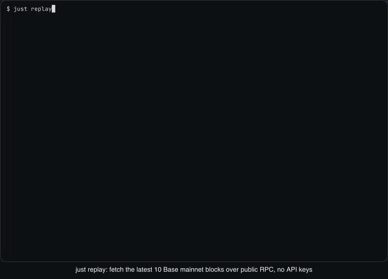

# needlefish

[](#installation)
[](#installation)
[](#design)
[](#installation)
[](LICENSE)

needlefish is [Base](https://base.org), the Ethereum L2, rewritten from scratch in Zig: execution
client, rollup consensus node, block builder, batcher, and tooling, with zero dependencies.
L2 blocks are full blocks at Base's native 200 ms subsecond cadence; there are no flashblocks.

It is a ground-up port of the public [base/base](https://github.com/base/base) repository and
keeps its layout, so every crate there has an obvious home here.

<p align="center">
  
</p>

`just replay` fetches the latest 10 Base mainnet blocks and the state they touch from public
RPC, re-executes them offline, and checks every header field against the chain
([docs/REPLAY.md](docs/REPLAY.md), [video](docs/assets/replay-demo.mp4)). `just replay 100`
does the same for 100 blocks: 100 consecutive mainnet blocks (1747 transactions) reproduce
exactly.

> [!WARNING]
> needlefish is not production-ready. Do not run it against a real network or with real funds.

## Design

- **Zero dependencies.** Only the Zig standard library: no C libraries, no vendored code,
  `build.zig.zon` has an empty `.dependencies`. Keccak, secp256k1, BN254, BLS12-381, KZG,
  brotli, the EVM, the trie, the storage engine, HTTP, and JSON-RPC are all implemented here.
- **TigerStyle.** Assertions on every precondition, postcondition, and invariant; static
  allocation at startup; every loop and queue bounded; no recursion; functions ≤ 70 lines.
  See [docs/TIGER_STYLE.md](docs/TIGER_STYLE.md).
- **Deterministic simulation testing.** All network, disk, time, and randomness go through an
  injected IO layer. The simulator runs the real component code on simulated infrastructure
  with fault injection, and any run replays exactly from its seed.
- **Fuzzed.** Every decoder, parser, and state machine has a coverage-guided fuzz target and a
  seeded fuzz run that executes with the normal test suite.
- **io_uring.** Completion-based IO on Linux, kqueue on macOS, the same API in simulation.
- **Fast.** Performance is designed in and measured; see [Benchmarks](#benchmarks).

## Benchmarks

needlefish and the Rust [base/base](https://github.com/base/base) stateless block executor
(`base-proof-executor`) replay the same 100 consecutive Base mainnet blocks (53775088..53775187,
1571 transactions, 271.9 Mgas) from the same witness on one Apple M4 Pro. Both reproduce every
canonical header. Median of 10 warm runs:

| Phase | needlefish | base/base |
| --- | ---: | ---: |
| Execution | 1717 Mgas/s, 1.23 ms/block | 626 Mgas/s, 3.83 ms/block |
| Execution + state root + receipts root | 1182 Mgas/s, 1.84 ms/block | 202 Mgas/s, 14.25 ms/block |
| Peak RSS | 289 MiB | 253 MiB |

base/base uses less memory. Its node (reth with a database and a parallel state root) is a
different code path and is not measured here. [docs/BENCHMARKS.md](docs/BENCHMARKS.md) has the
methodology, the 10-block fixture, cold runs, p90s, and `etc/bench/reproduce.sh`.
Micro benchmarks (`just bench`) are in [docs/PERF.md](docs/PERF.md).

## Installation

```sh
git clone https://github.com/refcell/needlefish && cd needlefish
just release
```

`just release` needs [`just`](https://github.com/casey/just) and `curl`. It uses Zig 0.17.1 from
`PATH`, or downloads it into `.cache/zig`, and writes optimized binaries to `zig-out/bin`.
needlefish has no other build dependency. There are no tagged releases; build from `main`.

## Usage

Everything ships in one multi-tool binary, `base`, mirroring base/base's `bin/` entry points as
subcommands: `node`, `consensus`, `batcher`, `proposer`, `challenger`, `replay`, operator tools,
and more. `base` with no arguments lists them all.

```sh
base version                    # version and git revision
base devnet init --out .devnet  # generate a local devnet: genesis, rollup config, JWT
base replay run src/infra/replay/testdata/base-mainnet-53715983-10.nfrp  # replay 10 mainnet blocks
just replay 100                 # fetch the latest 100 mainnet blocks and replay them offline
```

### Local devnet

The devnet runs natively, with no Docker and no external L1: needlefish brings its own L1 dev
chain.

```sh
just devnet up       # init configs, start every component
just devnet status   # pids and chain heads
just devnet smoke    # end to end: L2 tx sequenced, batched to L1, derived by the verifier
just devnet logs     # tail all logs
just devnet down     # stop everything
just devnet reset    # wipe .devnet/ and start fresh
```

| Process | Command | Ports |
| --- | --- | --- |
| L1 dev chain | `base node --dev-l1` | http 8545, beacon 5052 |
| L2 sequencer EL | `base node` | http 9545, engine 9551 |
| L2 sequencer CL | `base consensus --sequencer` | rpc 7545 |
| Batcher | `base batcher` | metrics 7300 |
| L2 verifier EL | `base node` | http 10545, engine 10551 |
| L2 verifier CL | `base consensus` | rpc 8547 |

L1 is chain 900 with 2 s blocks; L2 is chain 901 with native 200 ms blocks and every hardfork
active at genesis. Prefunded accounts come from the public dev mnemonic
`test test test test test test test test test test test junk`. Everything the devnet writes,
including the generated JWT secret, stays in the git-ignored `.devnet/` directory.
[docs/DEVNET.md](docs/DEVNET.md) has the full process contract, flags, and smoke test.

## Contributing

`just` lists every development recipe: tests, fuzzing, deterministic simulation, and
benchmarks. Contributor rules are in [AGENTS.md](AGENTS.md); the design is in
[docs/ARCHITECTURE.md](docs/ARCHITECTURE.md) and [docs/TIGER_STYLE.md](docs/TIGER_STYLE.md).

## License

[MIT](LICENSE).
